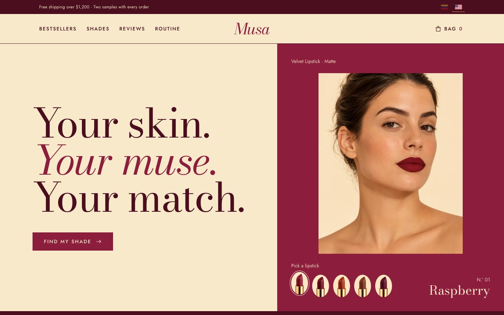
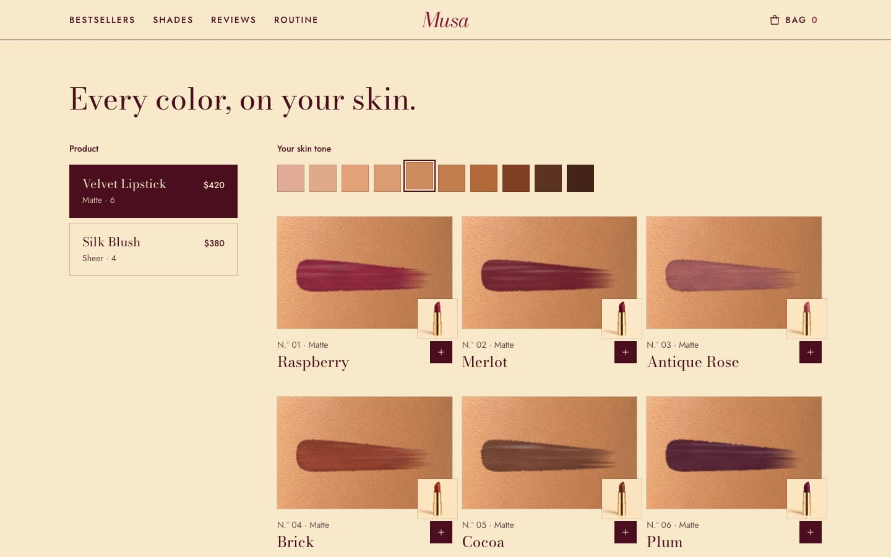
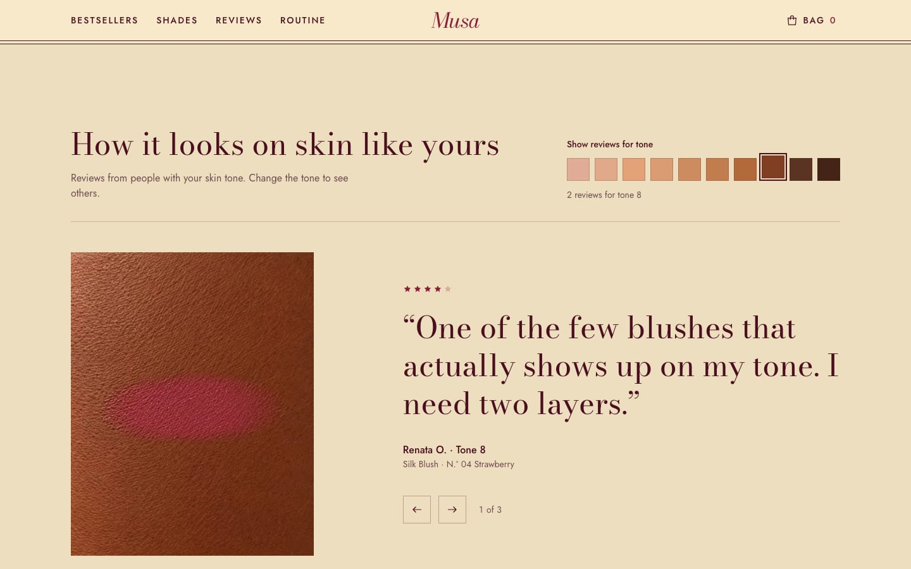
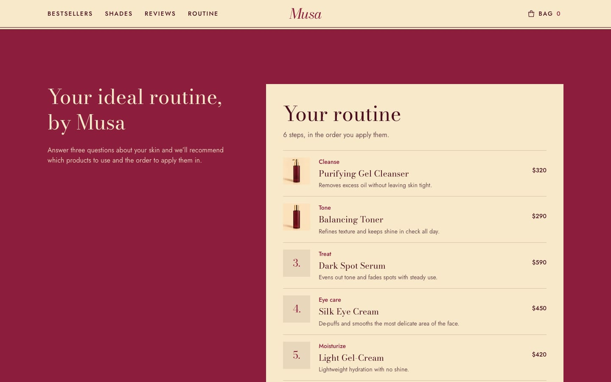
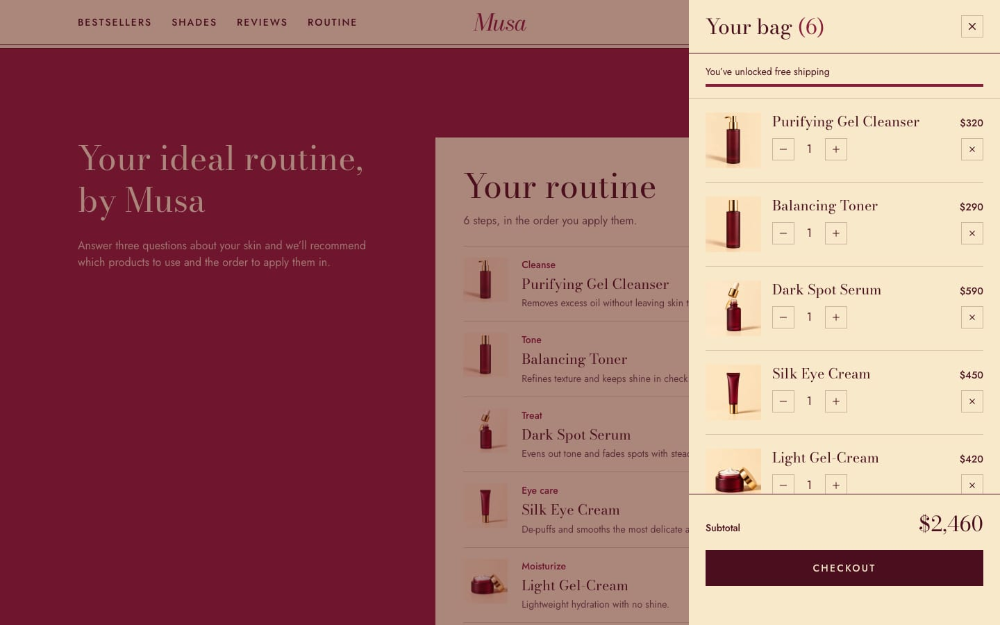
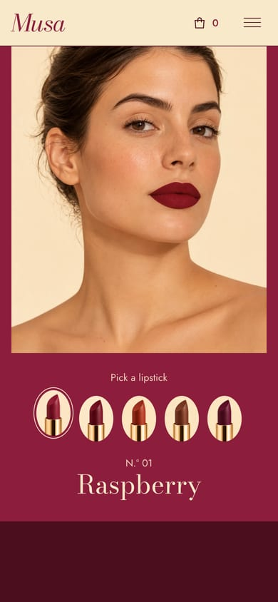

# Musa · Your skin. Your muse. Your match.

[](https://github.com/mgvillarreal/musa-beauty/actions/workflows/ci.yml)


A beauty store landing page built around one idea: **the same color looks different on every skin**. Try lipsticks on a model in real time, compare every shade on ten real skin tones, read reviews from people with your skin tone, and get a skincare routine from a three-question quiz.

> **Musa is a fictional brand** created as a portfolio concept project. Products, prices, reviews and orders are for demo purposes only. No real order or payment is ever made.



| Shade finder on ten skin tones | Reviews by skin tone |
|---|---|
|  |  |

| Routine quiz result | Bag | Mobile |
|---|---|---|
|  |  |  |

## Features

### Lipstick try-on (hero)
- Pick a lipstick and **the model's lips change color in real time**. The color is painted through a lip mask with a multiply blend, so the photo keeps its highlights, shadows and lip texture.
- The panel, the *Your muse.* line and the main button all fade to the chosen shade together. The shade lives in one CSS custom property registered with `@property`, so it animates instead of jumping.
- Lipstick picker as **oval cameos** of each product photo: the bullet and a bit of the gold tube.

### Shade finder
- Every lipstick and blush shown **on ten real skin photos**, from light to deep, based on the Monk Skin Tone Scale.
- **Realistic swatches drawn in code** (SVG filters, no extra images):
  - *Lipstick*: a dragged bullet with a firm rounded start, drag marks, slightly uneven pigment, a creamy sheen along the stroke and a feathered end.
  - *Blush*: a soft powder swipe with diffuse edges, denser in the center, with fine powder grain and subtle shimmer.
  - Each shade gets its own noise seed, so no two swatches look identical.
- Sheer products blend with the skin, so they nearly disappear on deep skin, just like in real life. That honesty is the point of the finder.

### Reviews by skin tone
- One review at a time, as a large featured quote next to a "photo" of the shade on the reviewer's skin.
- Shares the skin tone with the shade finder: pick tone 7 above, see tone 7 reviews here. If a tone has no reviews yet, it shows the closest tones and says so.

### Routine quiz
- Three questions (skin type, main concern, time) build a routine **in the order you apply it**, from a two-minute basic routine to a six-step ritual, including a "no routine yet" path for beginners.
- Add the whole routine to the bag in one click.

### Bag
- Side panel with quantities, a free-shipping progress bar and an animated subtotal.
- Bestseller cards, every shade in the finder and the quiz result can all add to the bag.

### Bilingual
- Spanish and English, switched with a flag and remembered for the next visit. Every string was reviewed so both versions sound natural, not translated.

## Quality at a glance

| | Mobile | Desktop |
|---|---|---|
| Lighthouse performance | 89 | 100 |
| Lighthouse accessibility | 100 | 100 |
| Lighthouse best practices | 100 | 100 |
| Lighthouse SEO | 100 | 100 |
| First Contentful Paint | 2.1 s | 0.5 s |
| Largest Contentful Paint | 3.5 s | 0.7 s |
| Total Blocking Time | 9 ms | 0 ms |
| Cumulative Layout Shift | 0.001 | 0 |
| Page weight | 605 KiB | 522 KiB |

Measured with Lighthouse 12.8 on the production build, median of three runs, with the real photos.
On mobile, the largest element is the hero photo. It downloads early (it is preloaded), but it is drawn by React, so on a throttled phone it waits for the JavaScript to run. Splitting the code was tried and made no measurable difference, because most of the bundle is the animation library the hero needs anyway.

**Accessibility**: axe-core reports **0 WCAG 2.0/2.1 A and AA violations** in 10 states (Spanish and English, every hero lipstick, blush on deep skin, mobile menu, bag, quiz question and result, newsletter error), on desktop and mobile. Automated tools catch a large share of issues, but not all of them, so keyboard and screen reader behavior is also covered by the end-to-end tests below.

## Design

- **Palette**: wine, raspberry, gold and cream on a light base, used in solid color blocks. No gradients, no glassmorphism.
- **Type**: Bodoni Moda for display, Jost for text, both self-hosted (Latin subset only).
- **Choices made to avoid the "AI template" look**:
  - Italic is used once, in the hero (*Your muse.*). Every other title is set plainly, at the same size.
  - Small caps are kept for what needs them (navigation, buttons, badges, footer headings). Everything else is normal text.
  - Two sections break the stacked-blocks rhythm: the shade finder takes the full screen, and reviews lead with one big quote.
  - Scroll animations are limited to three key moments: the hero, the statement band and the shade finder. Everything else simply appears.
- **One easing curve** for every animation, so motion feels like one brand.

## Accessibility

- Every picker (lipstick, skin tone, product, quiz answers) is a **native radio input**, fully usable with the keyboard, with visible focus.
- Skin tone squares show a **tooltip** with their name on hover and keyboard focus. Screen readers get the name from a hidden label.
- The bag is a **modal dialog**: the page behind it becomes `inert`, focus is trapped inside, Esc closes it and focus returns to the button that opened it. Additions are announced with a live region.
- The mobile menu follows the **disclosure pattern** (`aria-expanded`, closes with Esc or on selection).
- The quiz moves focus to each new question so screen readers announce where you are.
- Color contrast checked for the text colors against the backgrounds they sit on. Where gold on raspberry fell below 4.5:1, the text uses cream instead.
- Respects **reduced motion**: animations are skipped if the system asks for less motion.

## Responsive

- **Mobile**: menu behind a hamburger button, centered hero, stacked sections, landscape review photos.
- **Tablet**: hero stacked and centered, shade name pinned under the lipsticks, tighter section spacing.
- **Desktop**: full navigation from 1280 px. The hero photo scales to the viewport height so the whole hero fits on small laptops.

## Testing

End-to-end tests with [Playwright](https://playwright.dev/) run against the production build, on desktop (1280 × 900) and mobile (Pixel 7): **36 scenarios, 68 runs** (the hamburger menu tests only run on mobile, the full menu test only on desktop).

| Area | What is covered |
|---|---|
| Hero | Picking a lipstick updates the name, number, color and photo description; keyboard arrows move between lipsticks; the main button goes to the shade finder |
| Shade finder | Lipstick and blush shades, skin tone selection and its tooltip, adding a shade to the bag, "Choose a shade" from bestsellers |
| Reviews | Tone shared with the shade finder, previous / next with wrap-around, back to the first review on tone change |
| Routine quiz | "Next" disabled until answered, focus moves to each question, 6-step ritual in order with its total, beginner path, adding the routine to the bag, start over |
| Bag | Opens on add, focus trap, Esc returns focus, the page behind is inert, quantities, free shipping progress, empty state, demo checkout notice |
| Navigation | Mobile menu (state, links, Esc), desktop menu, newsletter validation |
| Languages | Switching to English (text, `lang`, title), `$` prices in both languages, translated products and reviews, remembered on reload |
| Accessibility | axe-core audit in 10 states |

GitHub Actions runs lint, type check, build and the whole suite on every push and pull request, and keeps the Playwright report as an artifact.

## Images

Product and skin photos are AI-generated with shared prompts, so every lipstick, blush and skin patch has the same framing and lighting. The originals stay out of git; a script turns them into optimized WebP files.

| Script | What it does |
|---|---|
| `npm run images` | Converts `assets/images/**/*.png` to WebP in two sizes, crops the lipstick cameos, builds a **texture map** for each skin photo (pores and relief only, neutral gray) and stores each photo's average color as its skin tone color. |
| `npm run lips-mask` | Builds an automatic lip mask from the hero photo: measures how red each pixel is, splits lips from skin with Otsu's threshold, fills highlights and smooths the edge. |
| `npm run lips-fit` | Places a hand-made lip mask (any size) over the photo, searching for the scale and position that best overlaps the automatic one. |

Some decisions came out of testing:
- Skin photos are **not** recolored to the exact Monk colors. That was tried, and it made light skin look like paper and deep skin like leather, because the Monk colors are muted reference swatches. Instead, the interface uses each photo's real average color.
- The skin texture shown through the swatches is a precomputed high-pass map. Doing it with SVG filters in the browser lightened the product color.

Every image has a fallback, so the page works with all, some or none of the photos.

## Tech stack

- [Vite](https://vite.dev/) + [React 19](https://react.dev/) + TypeScript
- [Tailwind CSS v4](https://tailwindcss.com/)
- [Motion](https://motion.dev/) for animation
- [Zustand](https://zustand.docs.pmnd.rs/) for state (shade finder, bag, language)
- [sharp](https://sharp.pixelplumbing.com/) for the image scripts
- [oxlint](https://oxc.rs/) for linting
- [Playwright](https://playwright.dev/) + [axe-core](https://github.com/dequelabs/axe-core) for end-to-end and accessibility tests, on GitHub Actions
- [Fontsource](https://fontsource.org/) for self-hosted fonts

## Project structure

```
src/
  components/
    shade/      Swatch (lipstick and powder), skin layers, tone fan, tone chips
    bag/        Bag side panel
    ui/         Wordmark, icons, stars, product images, language switch
  sections/     Header, Hero, Statement, Bestsellers, ShadeStudio, Reviews, RoutineQuiz, Footer
  data/         Catalog, skin tones, skincare and routine rules, reviews, bestsellers
  i18n/         Spanish and English strings
  store/        Shade finder and bag state
  lib/          Images, formatting, motion and shared styles
scripts/        Image optimization and lip mask tools
e2e/            End-to-end and accessibility tests
```

## Getting started

```bash
npm install
npm run dev       # development server
npm run build     # type check + production build
npm run preview   # serve the production build
npm run lint

npm run test:e2e     # all end-to-end and accessibility tests (desktop + mobile)
npm run test:e2e:ui  # Playwright UI mode
npm run test:a11y    # accessibility audit only
```

Locally, the tests use the installed Google Chrome; in CI, Playwright's Chromium.

## Credits

- Skin tones based on the [Monk Skin Tone Scale](https://skintone.google/) by Dr. Ellis Monk, licensed CC BY 4.0.
- Product, skin and model photos generated with AI for this concept.

---

A digital experience by **Gabriela Villarreal**.
